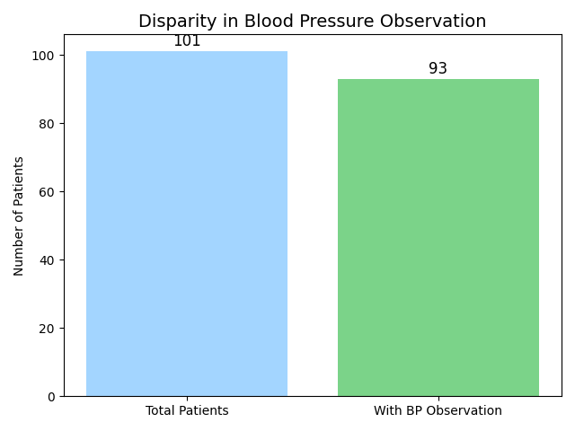

[Home](index.md) | [ETL](etl_pipeline.md) | [BPMN](BPMN.md) | [Insights](insights.md) | [Team](team_contb.md) | [About](About.md)

## FHIR-Facts from the Field

### Secure Access through Authorization

Accessing patient data from the source API (OpenEMR server) required proper OAuth2 authorization, including generating and using an access token. 
This security layer ensures that only authenticated users can retrieve sensitive patient information, which is essential for protecting patient privacy and complying with healthcare data regulations like HIPAA. 
Without a valid token, no data could be fetched, highlighting the API’s strong commitment to data security.

### Structured data with rich metadata

The source API provides structured patient data conforming to FHIR standards.
For example, the patient Trudie Bailey has clearly defined fields like "birthDate": "1980-02-21" and "gender": "female", enabling downstream applications to accurately interpret and utilize this data. 
The presence of metadata such as profile and versionId also ensures traceability and compliance with FHIR validation profiles.

## Roadblocks & Resolutions

### Missing Observations

The patient we selected did not have the blood pressure observation. So we had to create the observation with a sample structure from HL7's resource website.

Additionally, we wanted to analyze data from the openEMR server to see if this is a common occurrence. 

We identified that out of 101 total patients, 93 had blood pressure observations (LOINC 85354-9). This disparity is visualized below:

This challenge helped us experience a real world scenario where datasets often contain missing clinical entries which led us to find a solution.

### Validation Difficulties

After retrieving data from the OpenEMR server, we faced challenges validating resources before posting them to our custom FHIR server.

- We struggled with selecting the correct StructureDefinition/profile URL for each resource. 
- Many resources triggered validation errors and warnings, which required careful interpretation. 
- We had to repeatedly debug, ensuring that the extracted data was accurately transformed and mapped to the correct FHIR format. 
- Eventually, we learned to adjust both the content and the metadata (e.g., resource types and profile URLs) to meet validation standards, ensuring data integrity and interoperability.

This taught us the importance of robust data validation, FHIR profiling, and error-handling in real-world health informatics workflows.

## ETL the Right Way

- Understand the FHIR Resource Structure Early
- Always Validate Before Posting
- Ensure Consistent ID Mapping Across Systems

## Overall

This project provided practical experience with real-world healthcare data exchange using standards like FHIR, SNOMED, and HL7. We learned how to ensure interoperability between systems by integrating OpenEMR, Hermes, and Primary Care EHR. It strengthened our understanding of data validation, transformation, and resource linking in clinical workflows.