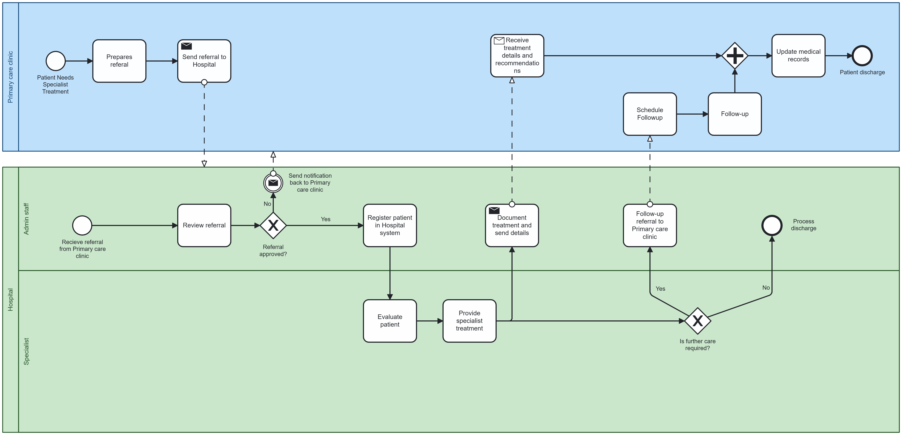

# Patient Referral Process Between Primary Care Clinic and Hospital
## BPMN Model Explanation
This BPMN diagram illustrates the patient referral workflow between a Primary Care Clinic and Hospital. The model represents the complete process from initial referral through treatment to follow-up care.
### Participants and Structure
The diagram contains two main participants:

* Primary Care Clinic: Initiates referrals and provides follow-up care
* Hospital: Divided into two lanes:
  * Admin Staff: Handles referral reviews and administrative tasks
  * Specialist: Conducts patient evaluation and treatment

### Process Overview
***Primary Care Clinic Process***

The process begins when a patient needs specialist treatment. The clinic prepares and sends a referral to the hospital. After specialist treatment, the clinic receives treatment details and may schedule follow-up appointments. Both information streams meet at a parallel gateway, ensuring medical records are updated comprehensively before patient discharge.

***Hospital Process***

Upon receiving a referral, administrative staff reviews it. If approved, the patient is registered in the hospital system; if rejected, notification is sent back to the clinic. The specialist evaluates the patient and provides treatment. Treatment details are documented and sent to the Primary Care Clinic. A decision point determines if further care is needed - either referring the patient back to the clinic for follow-up or discharging them directly.

### Communication Flows
The diagram shows four key message flows between organizations:

* Initial referral from Primary Care Clinic to Hospital
* Possible rejection notification from Hospital to Clinic
* Treatment details and recommendations from Hospital to Clinic
* Follow-up referral from Hospital back to Clinic when needed

